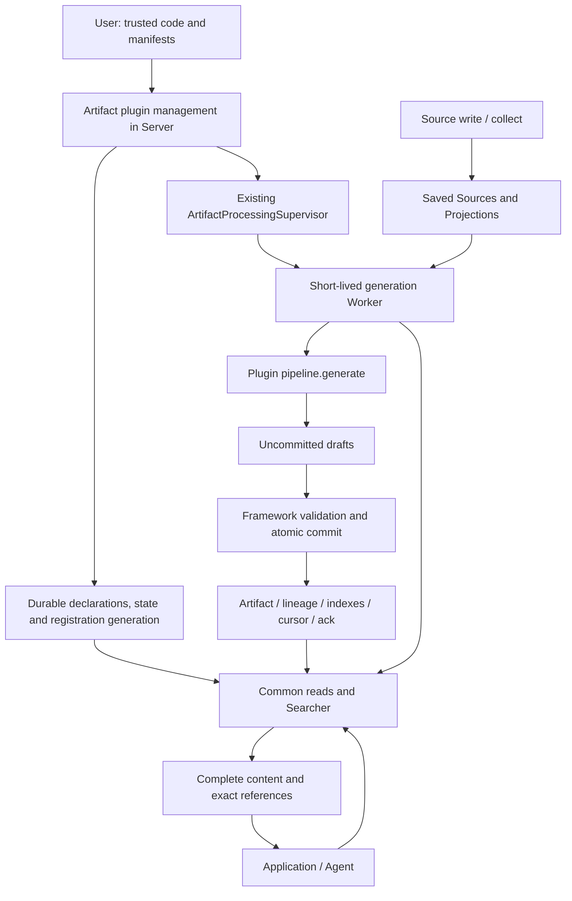

- Proposal Name: `artifact_plugin_framework`
- Start Date: 2026-10-20
- RFC PR: [#2175](https://github.com/oceanbase/powercontext/pull/2175)

# Summary

This proposal lets users define Artifact content, input Projections, and generation logic through Python plugins without
changing PowerContext core for each business domain. Server manages Artifact plugin declarations and lifecycle; the existing Supervisor
dispatches short-lived Workers whose generic processor invokes plugins and atomically saves results, index projections or
build-time change records, and consumption progress. Applications use common interfaces to read, search, and locate exact evidence, interpreting business
questions and computing answers themselves. One plugin declares one output family, one input contract, and one binding
(a stable registration for consumption and scheduling), and can serve multiple authorized Scopes.

This document specifies proposed behavior, not availability in mainline or released versions. Mainline foundations are
referenced against `0da4436d`. Interface names, configuration, and code illustrate the target contract; final syntax ships
with implementation. Optional search capabilities are exposed only when implementation, backend acceptance,
and capability discovery all support them.

# Motivation

Incident reports, case summaries, and embodied memory need different content structures and generation algorithms.
Built-in Artifact families cannot cover every domain. Copying scheduling, versioning, evidence, and search infrastructure
for every extension produces inconsistent failure and recovery behavior. Plugin authors should own how evidence becomes
content, while the framework owns execution, validation, commit, and retrieval.

[Source plugin RFC #2012](https://github.com/oceanbase/powercontext/pull/2012) addresses how external material enters
PowerContext: `write` synchronously saves caller-supplied content, while `collect` continuously acquires external material.
Artifact plugins address how saved material becomes reusable results. Generation failure does not require recollection,
and saved input remains consumable after a Source plugin stops.

For example, a Source plugin saves ticket snapshots and structured Projections; an Artifact plugin produces incident-report.
An application searches reports, reads exact revisions, and follows lineage to the snapshots actually used. Deciding whether
incidents are related, counting them, or answering natural-language questions belongs to the application.

# Guide-level explanation

## 1. Components and responsibilities



| Participant | Existing / new | Responsibility |
| --- | --- | --- |
| User | Existing role | Deploy trusted code and compatible dependencies, configure discovery and background identity, manage lifecycle and upgrades |
| Artifact plugin management in Server | New | Discover entries, validate declarations in a child process, persist registration, and coordinate changes to a single binding |
| Supervisor | Reused component | Scope dispatch, Worker budgets, tenure, timeouts, backoff, and completion verification |
| Artifact plugin generic processor (inside Worker) | New, reusing existing Worker execution | Load the factory, read a window, provide controlled resources, validate drafts, and commit results and progress |
| Artifact plugin | New extension contract | Declare inputs, output family, content schema, optional indexes and search modes; provide the factory and generation logic, and determine output IDs and evidence actually used |
| Framework read and index services | Extend existing services | Add durable-schema reads for custom families and declarative index assembly and rebuilding, reusing authorization and shared search interfaces |
| Application / Agent | Existing caller | Interpret questions, select evidence, assess completeness, compute domain results, and compose answers |

The Artifact plugin framework is a library, not another resident service like the Source plugin management service.
Supervisor dispatches Workers, which create and invoke an Artifact pipeline for each consumption invocation.

The Server parent does not import user Artifact modules. Declaration validation and generation execute in child processes.
Ordinary reads neither import plugins nor start generation Workers. Built-in families retain their domain processors and
share scheduling and consumption foundations with custom plugins.

## 2. Deployment, activation, and an Artifact generation example

Server discovers plugins under `POWERCONTEXT_SERVER_ARTIFACT_PLUGINS_DIR`. Each direct child contains `plugin.yml`,
and its directory entry name matches binding_name. Entries may point to predeployed immutable version directories;
historical packages stay outside the discovery directory.

```text
/opt/powercontext/artifact-plugins/
└── example-incident-report/
    ├── plugin.yml
    └── plugin.py
```

```yaml
id: example-incident-report            # Plugin identifier used to register ownership
version: "1"                           # Plugin code version, independent of content schema_version
entry: ./plugin.py:create_pipeline     # Factory entry; file path resolves relative to the plugin directory
binding_name: example-incident-report  # Stable consumption and scheduling identity; matches the discovery directory entry name
scope_ids: [team-a]                    # Existing Scopes to process; omit to discover backlog dynamically; grants no permission
max_sources: 20                        # Maximum Source entries scanned per invocation; filtering may yield fewer inputs
processing:                            # Supervisor scheduling and Worker execution settings
  interval_seconds: 60                 # Automatic pending-work check interval in seconds, measured between check starts
  max_workers: 1                       # Maximum concurrent Workers for this binding
  timeout_seconds: 300                 # Total timeout in seconds for one Worker execution
config:                                # Business configuration validated by the plugin Config model
  title_prefix: Ticket report          # Value used by the example plugin to populate report titles
```

An explicit scope_ids list must be nonempty and identify existing Scopes. The manifest does not store enabled state or
Server submission credentials. Secrets are managed through deployment resource references.

This plugin creates one report per exact ticket snapshot. The Source must already have saved
`powercontext.text-evidence@1` according to its Definition; the Artifact plugin does not revisit the ticket system.

```python
import hashlib
import json

from pydantic import BaseModel, ConfigDict
from powercontext.artifact_plugins import (
    ArtifactDraft, ArtifactFamily, GenerationBatch, GenerationContext, InputContract,
)
from powercontext.sources import SourceProjectionKey, TextEvidence

plugin_api_version = "1"


class Config(BaseModel):
    model_config = ConfigDict(extra="forbid", frozen=True)
    title_prefix: str = "Ticket report"


class IncidentReport(BaseModel):
    model_config = ConfigDict(extra="forbid", frozen=True)
    title: str
    evidence_text: str


families = (
    ArtifactFamily(
        family="incident-report", schema_version="1", content_model=IncidentReport,
    ),
)
inputs = InputContract(
    projections={
        "example-ticket": SourceProjectionKey(
            name="powercontext.text-evidence", version="1",
        ),
    },
)


class Pipeline:
    def __init__(self, config: Config) -> None:
        self.config = config

    async def generate(self, batch: GenerationBatch) -> list[ArtifactDraft]:
        drafts = []
        for source in batch.sources:
            evidence = TextEvidence.model_validate(source.value)
            identity = json.dumps(
                source.ref.model_dump(mode="json"),
                ensure_ascii=False, sort_keys=True, separators=(",", ":"),
            )
            drafts.append(ArtifactDraft(
                family="incident-report",
                schema_version="1",
                artifact_id=hashlib.sha256(identity.encode("utf-8")).hexdigest(),
                expected_revision=0,
                content=IncidentReport(
                    title=self.config.title_prefix, evidence_text=evidence.content,
                ).model_dump(mode="json"),
                source_refs=(source.ref,),
                artifact_refs=(),
            ))
        return drafts


async def create_pipeline(ctx: GenerationContext, config: Config) -> Pipeline:
    return Pipeline(config)
```

Initial discovery or explicit first reload leaves the plugin disabled. A user enables the plugins that were
loaded and disabled when this request began, then queries state to confirm the outcome:

```http
POST /v1/admin/artifact-plugins/enable-all
GET /v1/admin/artifact-plugins
```

First activation consumes retained, readable input from the journal beginning; reactivation continues from the durable
cursor. Example IDs are determined by exact Source identity within a Scope, independently of Worker IDs or retry counts.
Model failures raise exceptions rather than returning empty drafts. Return `[]` only when no output is needed, allowing
the framework to advance the window.

LLM plugins use the same contract: create their own model or network clients in the factory, register cleanup through
`ctx.enter_async_context(...)`, invoke the model within execution budgets in generate, and validate output.
Models do not invent identity or lineage: plugin code constructs these from actual evidence.
Structural validation does not establish factual correctness.

## 3. Consumption and querying are separate

Registration provides get / list by default. Applications access custom families through these common interface shapes:

| Purpose | Interface |
| --- | --- |
| Browse current collection | `GET /v1/scopes/{scope_id}/artifacts/{family}` |
| Current content | `GET /v1/scopes/{scope_id}/artifacts/{family}/{artifact_id}` |
| Exact version | `GET /v1/scopes/{scope_id}/artifacts/{family}/{artifact_id}/revisions/{revision}` |
| Declared search | `POST /v1/scopes/{scope_id}/artifacts/{family}/search` |
| Deployment capabilities | `GET /v1/capabilities` |

To enable full-text search, add a declaration to the output family before initial registration instead of implementing a query callback:

```python
from powercontext.artifact_plugins import ArtifactSearchDeclaration, TextIndex

search = ArtifactSearchDeclaration(
    version="1",
    indexes=(
        TextIndex(
            name="lexical", fields=("title", "evidence_text"),
            projection_version="1",
        ),
    ),
    modes=("text",),
    default_mode="text",
    defaults={"text": {"text": ("lexical",)}},
)
# Pass search to the preceding ArtifactFamily's search parameter.
```

Calling `/search` with `{"query":"timeout","mode":"text","limit":10}` returns complete reports and exact references.
Search yields bounded candidates. Top-k cannot establish a complete incident count or historical absence; enumeration
uses paginated list or a domain publication manifest. Disabling or unloading generation does not revoke saved reports,
historical evidence, or durable search declarations; availability during rebuilding follows Section 8.

# Reference-level explanation

## 4. Inputs, identity, and evidence

| Identity | Contract |
| --- | --- |
| Plugin id / version | Plugin ownership and code version, not process identity |
| Family | Output type; one custom family belongs to one binding and cannot override a built-in family |
| binding_name | Stable consumption identity; cursors are isolated by `(scope_id, binding_name)` |
| schema_version | Immutable content structure version, independent of plugin code |
| Artifact revision | Exact content version within Scope / family / artifact_id |
| binding_generation | Monotonically increasing registration generation that invalidates older assignments |
| Supervisor tenure / request generation | Existing execution ownership and completion semantics, separate from registration generation |

Plugin authors provide the following contracts. Loading validates declarations and identity conflicts without calling the factory.

| Plugin entry or declaration | Responsibility |
| --- | --- |
| `plugin_api_version` / `Config` | Declare a supported framework API version and define and validate plugin business configuration |
| `families` | Declare exactly one output family, its `schema_version`, and a JSON object content model |
| `inputs` | Provide a nonempty Source type to Projection name/version mapping; optionally declare additional readable Artifact families without granting permission |
| factory | Receive `GenerationContext` and validated configuration; create the pipeline and business resources for this invocation inside the Worker |
| `pipeline.generate(batch)` | Return pending drafts from inputs; the framework validates, persists, and advances progress |
| Optional `search` | Declare output-family indexes, modes, and defaults for framework-provided retrieval, not a business query callback |

Content models must produce persistently validatable JSON Schema; formats that cannot be decoded and validated after
unload are rejected before acceptance.
The content schema of an existing `(family, schema_version)` cannot change.

Each Source type selects one explicit Projection name and version. A plugin may accept different types such as tickets
and chat. Each GenerationSource contains exact ref, projection, and the original structured JSON value. Reading a stored
custom Projection requires neither Server nor the Artifact Worker to reload the Source plugin, and does not force
conversion to TextEvidence. A batch need not contain all types and does not implicitly pair inputs or wait for them.

GenerationContext fixes the current Scope and authorizes reads using the deployed background identity. It can read its
output family by default; inputs.artifact_families declares additional families. Declarations constrain access but grant
no permission and do not create Artifact dependency triggers.

- read_latest returns current content and an exact reference, with absence following the SDK's empty-result contract.
  read_revision reads the requested version and fails on absence without falling back to latest. Each read checks current permission.
- list_artifacts and search_artifacts select candidates. Even though search returns complete content, generation must
  explicitly read selected exact Artifacts to register evidence usable for lineage or an update precondition.
- ArtifactDraft contains family, schema_version, artifact_id, expected_revision, JSON object content, source_refs, and
  artifact_refs. A window cannot output the same Artifact identity twice.
- Creation uses expected_revision=0. Updating requires reading the existing version and providing its revision.
  When old content is used, include its exact reference in artifact_refs; using only its revision as an update condition
  does not require recording it as content evidence.
- The framework rejects unread, cross-Scope, or unauthorized evidence and rechecks permission and eligibility at commit.
  The plugin selects the evidence actually used; the framework cannot infer complete semantic dependencies from business code.

For example, after reading revision=3, the framework writes revision=4 only if head is still 3 at commit; otherwise the
whole window fails and must reread and recompute. Reads do not retain a transaction throughout model execution.
Consecutive latest reads or separate list pages do not form a cross-family snapshot. For historical consistency,
applications first pin an exact durable publication root and follow its exact-version manifest. Later publication cannot
rewrite the pinned evidence.

## 5. Artifact generation, commit, and failure

A Supervisor assignment specifies Scope and execution eligibility, not a Source list. The generic processor reads the
journal inside the Worker and uses the durable cursor to select a bounded window. Legitimate
lineage-only Sources and unaccepted types may be filtered while successful consumption advances the entire window.
An accepted type with a missing Projection, wrong version, or insufficient read permission fails the window; it is
neither silently skipped nor converted through another Projection.

```mermaid
sequenceDiagram
    participant S as Supervisor
    participant W as Artifact plugin generic processor (inside Worker)
    participant P as Plugin pipeline
    participant D as Durable storage
    S->>W: Scope assignment and registration generation
    W->>D: Read cursor, window and saved Projections
    W->>P: generate(batch), outside transaction
    P-->>W: drafts
    W->>W: Validate; prepare projections / embeddings when indexes are ready
    W->>D: Begin short transaction; recheck generation, permission, head, cursor
    W->>D: Atomically write revisions, lineage, projections or change records, cursor, ack
    D-->>W: Commit result
    W-->>S: Clean up resources and exit
    S->>D: Verify durable completion acknowledgment
```

Every consumption invocation creates a new pipeline, without reuse across windows, Scopes, or retries. No window or no
accepted input means no generate call, with the corresponding acknowledgment still completed. Nonempty input invokes
generate at most once. The successful transaction contains all drafts, exact lineage, cursor CAS, and acknowledgment,
plus affected projections when ready or change records during building. Commit coordinates with current index state
as specified in Section 8.3. Newly arriving Sources belong to later windows; completion cannot swallow a later request generation.
Output, evidence, head, or cursor conflicts roll back the whole window.

| Failure point | Outcome and recovery |
| --- | --- |
| Loading, resource initialization, reading, generation, or ready-index projection preparation | No commit or progress; clean up registered resources and use existing retry backoff |
| Precommit validation or writing | Roll back the whole transaction; reread and regenerate |
| Unknown commit result | A later protected invocation checks durable cursor and ack; do not assume rollback and write under a new ID |
| Postcommit cleanup or exit reporting | Committed results remain valid; do not consume an acknowledged window again |
| Worker timeout with successful reclamation | Release capacity and retry according to policy after confirmed exit |
| Unconfirmed Worker exit or lost Supervisor tenure | Use existing tenure revocation and reclamation protection, potentially pausing other bindings |

A normal process exit cannot replace durable acknowledgment. Persistent bad input requires repair or disabling the
binding, not automatic skipping after repeated failures. Generation may repeat computation; model calls, billing, and
external side effects are not exactly once. Forced termination cannot guarantee cleanup callbacks or remote cancellation.

Invocation limits include a total Worker timeout, per-binding concurrency, window entries, and finite input-byte,
output-count, and output-byte budgets. Measure input using complete Projection JSON serialization before generation;
check output before commit. Exceeding a limit fails explicitly without truncation or partial persistence. Implementation
PRs specify defaults and configuration; a return-value limit is not a memory sandbox.

## 6. Hot management, recovery, and upgrades

Startup automatically discovers only new entries, validates them independently, and registers successful ones as disabled.
One invalid entry does not prevent other valid entries. Existing plugins restore durable configuration and management
state; scanning does not implicitly upgrade or reenable them. Runtime additions and upgrades explicitly reload; the
framework does not watch files or install dependencies. Code and dependencies are predeployed; persist the resolved
version directory and code fingerprint and recheck them in Workers. Fingerprints do not replace dependency locking or trust.

| State | Meaning |
| --- | --- |
| disabled | Valid definition saved, generation paused |
| enabled | Attached and eligible for dispatch and commit |
| unloaded | No execution attachment or configuration snapshot; identity, generation, schemas, content, and cursors retained |
| failed | An accepted management transition failed; generation paused until repair/reload or disable/unload |
| activating / stopping / unloading | Desired change accepted but incomplete; not proof of activation or exit |

Persist desired_state and phase; only phase=enabled permits dispatch and commit. Transitions serialize per binding and
conflicting changes during transition fail. A time-limited validation child checks a candidate without calling the factory
or creating model connections. Validation failure preserves the old definition and state; failed initial validation creates
no valid registration.

In the first release, initial registration fixes the family search declaration's version, complete index definitions (`indexes`),
and schema identity. Changing the declaration version, adding, removing, or renaming indexes, or changing their types,
projection_version, profiles, field or fragment mappings, or other index definitions returns a conflict (HTTP 409) before acceptance, preserving the previous declaration and
index state without interrupting existing search. This applies even to empty databases and survives unload and restart.
Reloads may update generation code, ordinary configuration, Scopes, and only these query-policy fields of ArtifactSearchDeclaration:
modes, default_mode, defaults, candidate_limit, rrf_k, text_weight, and vector_weight. Policy updates must pass existing declaration
validation and are persisted through the reload acceptance flow below, without changing the normal Worker lifecycle.
Section 8.2 defines availability and policy reads.
An existing family with search also rejects a previously unregistered schema_version under the same rules, even if search is identical.
A family without search may add schema_version values under the content-version rules, but must remain without search;
search omitted at initial registration cannot be added later.

After validation, permitted changes to plugin definitions or configuration proceed through expected_generation checking
and durable acceptance with a generation increment, stopping dispatch and reclaiming old Workers, confirming exit,
attaching the new definition, then resuming
permitted scheduling and reconciling backlog. Reclamation runs outside database transactions. Failure after acceptance
enters failed without restoring an old generation. Unconfirmed old Worker exit prevents successful unload reporting or
replacement execution.

Management transitions preserve existing search readiness. Generation for the target binding remains
paused during the management transition; after it completes, resuming generation does not wait for index building.

Whenever Supervisor dispatches a task, it records the plugin's current registration generation (`binding_generation`)
in the task; the Worker checks that this generation is still valid when starting and committing results. Management revocation and business commit
must coordinate atomically, with protection covering the entire result / cursor / ack transaction: a commit that wins is
retained; revocation that wins rejects the entire old Worker commit. Late events cannot mutate new-generation state.
Normal per-plugin operations do not revoke the shared Supervisor tenure.

Management requires `server.admin` and uses binding names under the discovery directory. Requests do not upload code,
provide arbitrary paths, or submit configuration:

| Interface (prefix `/v1/admin/artifact-plugins`) | Meaning |
| --- | --- |
| `GET /`, `GET /{binding_name}` | State, generation, definition summary, and safe diagnostics without secrets |
| `POST /enable-all` | Capture currently disabled plugins and generations, enable independently; no discovery or rollback of other successes |
| `POST /{binding_name}/reload` | Revalidate the directory entry and register it; normal updates retain the enabled/disabled target |
| `POST /{binding_name}/enable` | Enable the saved valid definition; unloaded requires reload first |
| `POST /{binding_name}/disable` | Revoke old execution while retaining the definition |
| `POST /{binding_name}/unload` | Revoke/reclaim execution and remove attachment/configuration snapshot without deleting code or business data |

Single-plugin mutations carry expected_generation: 0 for initial registration, otherwise the value returned by GET.
Stale generations conflict. An identical definition and already stable target may return current state. Asynchronous
acceptance returns 202 with a status location; query after response loss. enable-all takes no body and skips enabled,
unloaded, failed, and transitioning entries. Report concurrent changes as per-item conflicts; GET confirms final state.

Normal reload preserves enabled / disabled; initial reload, reload after unload, and repair of failed state result in
disabled. Restart restores durable targets and continues unfinished transitions. Restoring enabled revalidates code and
increments generation; failures remain failed rather than requiring all healthy plugins to repeat enable-all.
Scanning does not revive unloaded registrations. Ownership survives unload, so reinstall cannot take over another plugin's family.

Dynamic discovery covers backlog from before registration and future Scopes. Explicit lists change through reload;
removing a Scope preserves its cursor and results. Compatible updates affect only unconsumed windows; rollback does not
rewind schemas, data, or cursors. Adding an input type does not backfill records already passed by the cursor.
Historical replay and identity migration need separate design. Ordinary generation failure does not change management phase to failed.

## 7. Persistence and interface compatibility

| Data | Arrangement |
| --- | --- |
| Plugin registration | Extend `pc_artifact_processing_binding_states` with ownership, configuration snapshot, binding_generation, desired_state, phase, and last_error |
| Content declarations | Add `pc_artifact_family_schemas`; persist immutable content schemas, fixed index definitions, and updatable query policies |
| Artifact content | Reuse `pc_artifacts`, `pc_artifact_heads`, lineage, and the shared writer; store schema_version with each revision |
| Consumption and scheduling | Reuse `pc_source_cursors`, intent, lease, and acknowledgment without new execution-history or commit-receipt tables |
| Indexes | Framework-owned derived projections, a single target configuration, and build progress |

A generic JSON codec reads using the revision's durable schema rather than an importable Python class. The content structure
of an existing `(family, schema_version)` is immutable. Families without search may evolve content through new schema_version
values; existing families with search cannot add unregistered content versions. Historical content retains its original
interpretation, and rebuilding does not rewrite content or lineage. Unload preserves historical reads and schemas.
Registering a family does
not automatically expose generic creation, tags, review, or Recall; discovery must reflect implemented operations.

OpenAPI, the SDK, runtime family registration, and public read interfaces must support custom families registered by plugins.

Custom search uses `/search` and the shared SDK search interface, returning Artifact content and exact references.
Durable search declarations must resolve to named indexes. Reject incompatible storage before accepting writes;
conversion and rebuilding must preserve historical content and its schema interpretation.

## 8. Shared search and optional indexes

### 8.1 Search capabilities and requests

An optional search declaration gives plugins text, vector, or hybrid retrieval without implementing query callbacks.
Applications select named indexes and receive complete Artifacts, exact revision references, and optional scores.
Families without search declarations remain readable through get/list. Search covers currently eligible content;
exact references provide historical reads.

HTTP, SDK, and GenerationContext share ArtifactSearchService, with the framework assembling a generic ArtifactSearcher
from declarations. Built-in families retain their own strategies. Search and index maintenance run independently of
generation bindings and can use durable declarations after generation is disabled, unloaded, or its code removed.
Deployment supplies encoding resources managed by the framework, independently of the generation factory;
a compatible query vector requires no query-encoder invocation.

| Field | Custom-family request contract |
| --- | --- |
| mode | text / vector / hybrid; omission uses the declared default, never a failure-driven fallback |
| query | Ordinary, nonempty text, at most 8192 characters; required for text/hybrid |
| query_vector | Values and complete EmbeddingProfile; vector requires exactly one of query/query_vector; hybrid requires query and optionally a compatible vector |
| indexes | Named indexes selected by text/vector, such as `{"text":["lexical"],"vector":["semantic"]}`; omission uses declared defaults; ambiguity fails |
| limit / include_scores | limit defaults to 10, range 1–200 Artifacts; include_scores defaults to false |
| Other parameters | fusion, min_score, filters, admission, and rerank accepted only in declared and implemented combinations |

The shared request contract must support vector-only input while retaining built-in families' request constraints.
Responses reuse SearchArtifactsResponse.results: family, artifact_id, revision, complete content, lineage, and optional
scores; schema_version follows the public content representation. retrieval is finite and within [0,1]; channels retain
raw metrics and direction. Scores are not comparable probabilities across queries or families.

Unknown families return 404; invalid input, unsupported parameters, or incompatible spaces return 422;
unready declared capabilities or unavailable required resources return 503. Authorization and internal errors retain
401/403/500. Only successful searches without matches return empty results; required hybrid-channel failure does not degrade.
`/v1/capabilities` describes deployment support; Section 8.3 determines index availability within a Scope.
Recall needs explicit integration into existing orchestration, preserving permission, exact references, and candidate/context
budgets; registering a family does not enable it automatically.

### 8.2 Index declarations and result selection

A plugin declares one content schema_version at a time. Its search declaration defines index names, extraction rules,
projection_version, supported modes, defaults, and parameter constraints for that content schema. Index names are unique
within a family. The version, indexes, and schema identity are fixed; only the query-policy fields listed in Section 6 may change.
The first release does not provide extraction-rule configuration for multiple schemas. Search covers all active heads applicable
to selected indexes, without skipping declared but incompletely built parts.

Policy updates keep ready indexes available without rebuilding, suspending search, re-encoding, or changing unfinished build
progress. Queries read the latest policy from the durable declaration, including during building and after restart or unload;
concurrent in-flight queries retain their consistent read snapshots. Build manifests retain their build-time snapshots, index
identities, and progress rather than serving as the source of current query policy. Policy updates do not traverse or update
all Scopes and introduce no configuration endpoint.

| Capability | Plugin declares or supplies | Framework responsibility |
| --- | --- | --- |
| Text search | Required top-level string fields and a named index | Extract and index text with Chinese/English analysis; match ordinary query text using keyword OR |
| Vectors generated from text | Durable text fields or fragments, a vector space, and a named index | Use compatible encoders for document/query vectors; maintain and rebuild the index |
| Plugin-owned vectors | Vectors or fragment arrays in content, their model/space identity, and a named index | Validate, extract, and index durable vectors; search within compatible spaces |

For example, a report can index its title and body in a lexical text index and its body in a semantic vector index,
with framework-generated embeddings. Applications use text mode for keyword matching and hybrid mode to combine the two
indexes. Plugins with existing image features may instead persist and declare their vectors without framework re-encoding
of the original images. Analysis and indexing leave original content intact.

Vectors reuse EmbeddingProfile: profile_id, model, dimension, distance=l2, and normalization=none / unit.
Equal dimensions do not imply compatibility; model, modality, and preprocessing semantics must be explicit, without inferring
information absent from old records. Plugin-owned vectors persist a complete EmbeddingProfile in the corresponding
content revision, extracted through the declared profile_field; fragment arrays store the corresponding profile in each
fragment. The framework validates space compatibility against the complete definition, and historical vectors retain their
model identity independently of the current search declaration.
Selected vector indexes must share a compatible query space. Image spaces without a compatible text encoder accept query vectors only.

Some built-in PowerContext retrieval paths already use native ANN. Custom Artifacts currently use exact L2 and have not
yet integrated native ANN indexes and candidate queries.

Vectors must be finite and correctly dimensioned; unit preparation follows shared normalization
or validation rules and rejects zero vectors as unit vectors. Single vectors and explicit plugin-supplied fragment arrays
are supported without automatic chunking. Fragment IDs are unique within a revision/index. Empty arrays are legitimate
zero-fragment results; missing required fields, duplicate IDs, and invalid vectors fail explicitly.

Named indexes select the retrieval scope. Selected indexes feed text/vector scoring channels; fusion weights and
scores.channels use text/vector as keys. Each index filters by Scope, authorization, and active status before computing
relevance and selecting each Artifact's best fragment. The same Artifact revision retains its best raw score across indexes
of the same kind, with the channel candidate budget applied after merging. Only hybrid uses two-channel weighted RRF; its calculation and normalization formulas are described in
[search fusion strategies](../docs/workflows/search-fusion.md); declarations constrain configurable parameters.
Repeated matches across indexes of the same kind do not accumulate contributions. Apply min_score to the final normalized
score before the Artifact limit, with stable identity ordering for ties. Fragment counts neither consume extra candidate
slots nor produce repeated score contributions.

Result reads follow the [search projection contract](1803-artifact-search-projections.md): all channels and content
hydration share a consistent read view, use only selected indexes from one build, and return exact matched revisions.
Query encoding runs outside transactions, followed by a build-state recheck; changes return unavailability.
OceanBase retrieval avoids business-table JOINs: eligibility lives in projections or pre-established conditions,
followed by batch reads of exact content.

### 8.3 Index maintenance and availability

The framework's index-maintenance runtime builds and recovers indexes; plugins supply declarations and content.
Each Scope/family stores one target index configuration, along with durable index definitions and spaces, build progress,
projection completion records, and build-time content changes. Completion records identify the exact revision processed,
including legitimate zero-fragment results. Content, heads, and lineage retain their identities; derived indexes can be rebuilt.

| State | Search | Content reads and writes |
| --- | --- | --- |
| All target indexes are ready and required request resources are available | Retrieval follows declarations | get/list/exact historical reads work; content, affected indexes, completion records, and consumption progress commit atomically; projection failure fails that write |
| Initial build, cleanup, rebuilding, or failed-build retry | Every valid search for the Scope/family returns 503, including requests only for a completed text index | Reads continue; content, consumption progress, and change records commit atomically; old indexes are not maintained, and unready target encoders or physical spaces do not block content writes |

Deletion, restoration, and eligibility changes follow the same update rules. Commits recheck current index state so
concurrent writes cannot omit change records or bypass maintenance of newly ready indexes. Authorization, version, and
evidence checks remain in force in every state. A complete but empty index may be ready. An empty text Scope without
current heads or index state may return empty results after request validation and authorization.

A family's first content write establishes index state if search is declared. The first release retains initial building,
incremental content maintenance, and recovery after failures or restarts. The framework may internally rebuild the complete
index set for repair under the same index definitions; selective rebuilding and new public management endpoints are not provided.
During initial building or internal repair rebuilding, search for the Scope/family is unavailable as shown above:

1. **Register the build and clean up:** use the fixed index definitions and persist build_id; repair rebuilding removes existing projections and completion records in batches.
2. **Backfill and catch up:** scan current content and use commit-ordered change records to process concurrent writes, deletions,
   and eligibility changes; projections, completion records, and progress commit together.
3. **Validate and resume:** verify that all applicable content is processed, no obsolete fragments remain, and no concurrent
   changes are missed, then mark the entire index set ready atomically. Further changes require catch-up;
   do not open individual channels.

build_id is independent of content revisions and plugin registration generations. Cleanup, building, and search resumption
check it so obsolete tasks cannot affect a new build. Model computation runs outside transactions; saving rechecks content
version, eligibility, and build identity. Failures and restarts resume from durable progress, including unfinished cleanup work.
Cleanup affects only that Scope/family's derived data, preserving shared storage and other data,
and protects in-flight consistent read views, waiting for queries to finish when necessary.

Rebuilding does not rerun generation, advance Source cursors, or rewrite content or lineage. Framework-generated text
vectors can be re-encoded from persisted text. Plugin-owned vectors are restored from persisted content under the original
index definitions. Online index-definition migration and vector migration are not provided. Historical revisions retain their original
schema and model meaning.

Disabling or unloading generation does not prevent index recovery. Missing resources preserve progress for retry;
ongoing writes can extend readiness time. Maintenance handles only explicitly triggered and unfinished work, without
periodic traversal of every family/Scope combination or a new scheduler, queue table, or configuration.
Ready indexes are not rebuilt on restart.

The framework manages storage: SQLite shares a vector table; OceanBase/seekDB use native VECTOR(d) tables per complete
space, without reusing Memory-specific tables. Projections retain Scope, family, revision, index, fragment, and build
identities and validate complete profile associations; plugins do not specify physical tables or DDL.
Unified database initialization creates and validates missing management tables, text indexes, and vector spaces;
reload, content writes, and background builds only manipulate data. If a new plugin's initial registration requires a native
vector space that is not yet provisioned, database initialization must run again, for example on Server restart, before building
can start; the unavailable state in the table above applies meanwhile.
Existing-table upgrades and full versioned migrations remain outside this proposal.
Backends must provide atomic updates and consistent reads before exposing the corresponding capabilities.

# Drawbacks

Trusted Python plugins run with the Worker's operating-system permissions and can access its available files, network,
and credentials. A controlled SDK constrains standard calls, not arbitrary Python system access. Child processes isolate
ordinary failures without providing an untrusted-code sandbox, supply-chain verification, or hard memory/CPU quotas.
Stronger isolation belongs to deployment.

Per-window loading and initialization cost work; shared environments require compatible dependencies. Synchronous index
maintenance when ready increases write latency, and required projection failures can block that content commit.
Rebuilding makes search unavailable while content writes continue; ongoing writes can extend catch-up and readiness validation.
Plugin-owned vectors are stored in both content and indexes, increasing storage costs.

# Rationale and alternatives

| Approach | Tradeoff |
| --- | --- |
| Modify core for every family | Direct integration, but domain extensions depend on core releases and duplicate version/consumption logic |
| One resident instance per plugin | Amortizes initialization but adds state reuse, cancellation, and upgrade protocols beyond per-window needs |
| Worker calls a remote generator | Fits dedicated compute, user-side networks, or other languages; requires identity, evidence serialization, timeout, cancellation, and late-result protocols |

Framework interpretation of durable schemas, instead
of plugin readers, enables reads and rebuilding after unload. Business queries stay in applications so question types and
answer protocols do not depend on generation lifecycle.

Shared vector projections preserve family, multiple indexes, fragments, and build identities rather than reusing Memory-specific
tables. Exact L2 is the current adaptation choice, not a framework restriction on backend capabilities. Integrating existing
ANN capabilities into custom indexes must define approximate-retrieval semantics and handling of insufficient candidates
after fragment folding and authorization filtering, while preserving index isolation, eligibility checks, Artifact
deduplication, and exact-revision reads.

# Prior art

| Reused mainline foundation | General capability added by this proposal |
| --- | --- |
| Supervisor and Worker execution/reclamation | Plugin declaration validation, registration, and hot management |
| Source journal/cursors, controlled evidence reads, and transactional commits | Generic generation processor consuming durable Projections under an input contract |
| Artifact revisions, heads, lineage, and common reads | Durable-schema-driven validation and reading of custom content |
| Artifact Search dispatch and common search contracts | Optional declarative index assembly, rebuilding, and readiness of the complete index set |

- [Source plugin RFC #2012](https://github.com/oceanbase/powercontext/pull/2012) defines ingestion boundaries;
  this proposal consumes saved data without duplicating collection-target management.
- [Source Definition / Observation](1400_source_definition_and_observation_model.md) and
  [Generation evidence admission](1458_artifact_generation_source_access.md) define data and evidence contracts.
- [Artifact processing supervisor](1515_artifact_processing_supervisor.md),
  [Family unification](1549_artifact_family_unification.md),
  [Unified Artifact Search](1858-artifact-search.md), and
  [Search projections](1803-artifact-search-projections.md) provide scheduling, storage, and candidate boundaries.
- [Unified database migrations](1771-unified-database-migrations.md) discusses existing-table upgrades and versioned migrations.

# Unresolved questions

Implementation PRs supply concrete choices and evidence for maintainer approval before each capability's first release.
These questions do not defer atomic commit, registration fencing, or historical-read requirements.

| Topic | Fixed boundary and remaining decision |
| --- | --- |
| SDK and content schemas | API v1 has one family; finalize exports and the persistently supported JSON Schema subset |
| Budgets and resources | Execution must be bounded without partial commits on overflow; specify configuration defaults, workload budgets, and diagnostics |
| Backend matrix | Advertise modes only after actual acceptance; document SQLite/OceanBase/seekDB versions, tested scale, and maintenance limits |
| Observability | Reuse existing identities, operation vocabulary, and log_safely without content, vectors, or secrets; register new fields per developer guidance and update both locales |

# Future possibilities

The following extensions can be designed separately and are outside this proposal:

- **Generation**: remote generation, resident pipelines, multi-family output, historical replay, and consuming multiple Projections of one Source.
- **Plugin management**: complete plugin-data deletion, execution histories and receipts, code distribution, signatures, and security sandboxes.
- **Search**: online index-definition migration, vector migration, selective rebuilding, other distance metrics, arbitrary JSON indexes, and historical-revision search, with separate budget, compatibility, and accuracy decisions.

Cross-Scope generation, arbitrary Artifact dependency triggers, automatic window splitting to skip bad input, business query
handlers, and a generic task queue remain outside this proposal.
