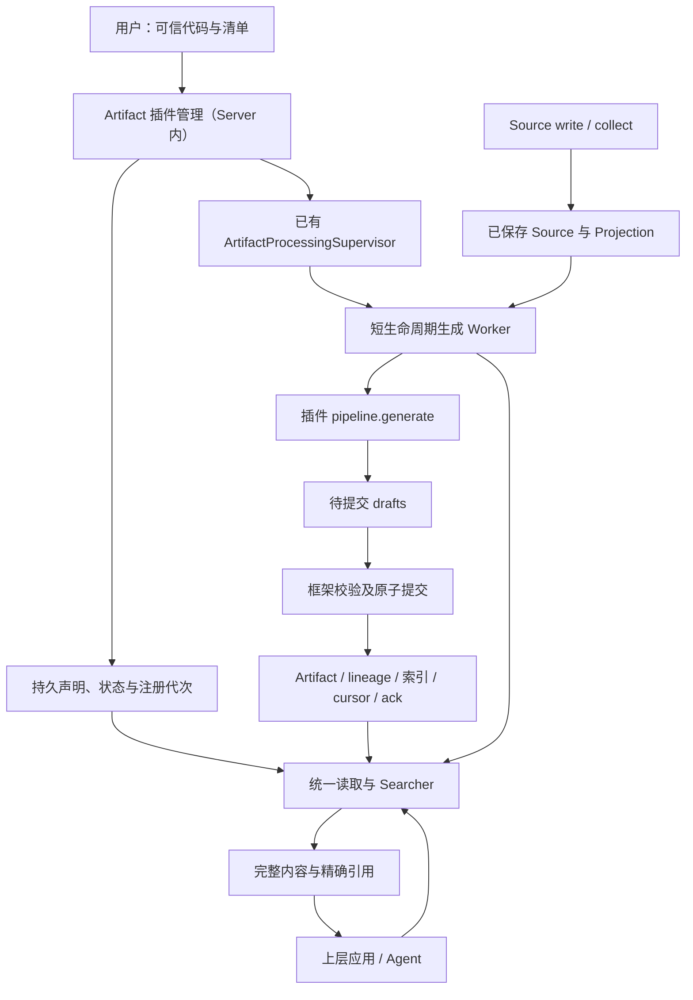
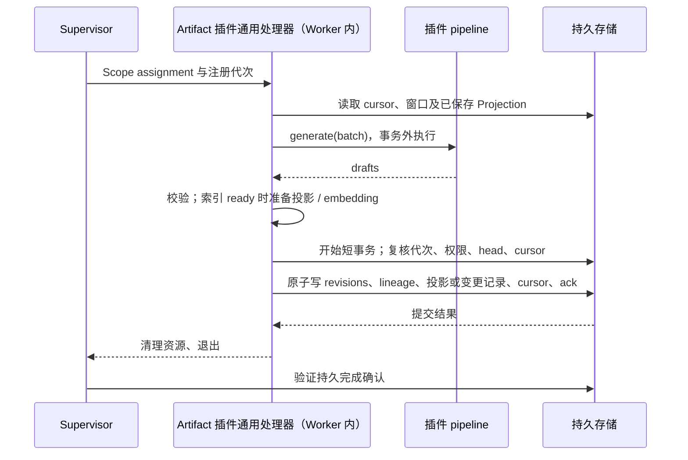

- Proposal Name: `artifact_plugin_framework`
- Start Date: 2026-10-20
- RFC PR: [#2175](https://github.com/oceanbase/powercontext/pull/2175)

# 概要

本提案让用户通过 Python 插件定义 Artifact 的内容结构、输入 Projection 和生成逻辑，无需为每种业务修改
PowerContext 核心。Server 管理 Artifact 插件声明与生命周期，已有 Supervisor 派发短生命周期 Worker，Worker 中的通用处理器
调用插件并原子保存结果、索引投影或构建变更记录及消费进度。应用通过统一接口读取、检索和定位精确证据，在应用层理解业务问题、
组合证据并计算答案。一个插件声明一个输出 family、一个输入契约和一个 binding（稳定的消费与调度登记），
可服务多个获授权 Scope。

本文规定提议的行为，不表示这些能力已在主线或发布版本中可用。主线基础以 `0da4436d` 为参照；接口名称、配置和
代码用于说明目标契约，最终语法随实现发布。可选检索能力只有在实现、后端验收及能力发现均支持时才对外开放。

# 动机

工单报告、案件摘要、具身记忆等业务需要不同的内容结构和生成算法。内置 Artifact family 无法穷尽这些需求，
而每个扩展都复制调度、版本、证据和检索基础设施，会产生不同的失败及恢复语义。插件作者应专注于如何从证据
生成内容，框架负责何时运行、如何验证、如何提交和如何读取。

[Source 插件 RFC #2012](https://github.com/oceanbase/powercontext/pull/2012)解决外部资料如何进入 PowerContext：
`write` 同步保存调用者提供的内容，`collect` 持续采集外部资料。Artifact 插件解决保存后的资料如何生成可复用结果。
生成失败不要求重新采集；Source 插件停止后仍可消费已经保存的输入。

例如，Source 插件保存工单快照及结构化 Projection，Artifact 插件生成 incident-report。应用检索报告，读取其
精确 revision，并沿 lineage 找到实际使用的快照。判断事故是否相关、统计次数或回答自然语言问题属于应用。

# 使用层说明

## 1. 组件与职责



| 参与者 | 已有 / 新增 | 职责 |
| --- | --- | --- |
| 用户 | 已有角色 | 部署可信代码和兼容依赖，配置目录与后台身份，管理启停及升级 |
| Artifact 插件管理（Server 内） | 新增 | 发现入口，在子进程校验声明，持久注册并协调单 binding 的切换 |
| Supervisor | 复用已有组件 | Scope 派发、Worker 预算、任期、超时、退避和完成确认 |
| Artifact 插件通用处理器（Worker 内） | 新增，复用已有 Worker 执行机制 | 加载工厂、读取窗口、提供受控资源、验证 drafts、提交结果和进度 |
| Artifact 插件 | 新增扩展契约 | 声明输入、输出 family、内容 schema，以及可选索引和检索模式；提供工厂与生成逻辑，确定输出 ID 和实际使用的证据 |
| 框架读取与索引服务 | 扩展已有服务 | 增加自定义 family 的持久 schema 读取、声明式索引装配与重建，复用权限校验和统一检索接口 |
| 应用 / Agent | 已有调用方 | 理解问题、选择证据、判断完整性、进行业务计算并组织答案 |

Artifact 插件框架是库，不新增 Source 插件管理服务式的常驻组件。
Supervisor 派发 Worker，由 Worker 在每次消费时创建并调用 Artifact pipeline。

Server 父进程不导入用户 Artifact 模块。声明校验和生成均在子进程执行，普通读取不导入插件，也不启动生成 Worker。
内置 family 保留各自领域处理器，与自定义插件共用调度及消费基础。

## 2. 部署、启用与 Artifact 生成示例

Server 使用 `POWERCONTEXT_SERVER_ARTIFACT_PLUGINS_DIR` 指定统一发现目录。每个直接子目录包含 `plugin.yml`，
目录项名称与 `binding_name` 一致。发现目录项可链接到预部署的不可变版本目录，历史包置于发现目录之外。

```text
/opt/powercontext/artifact-plugins/
└── example-incident-report/
    ├── plugin.yml
    └── plugin.py
```

```yaml
id: example-incident-report            # 插件标识，用于登记插件归属
version: "1"                           # 插件代码版本，独立于内容 schema_version
entry: ./plugin.py:create_pipeline     # 工厂入口，文件路径相对插件目录解析
binding_name: example-incident-report  # 稳定的消费与调度标识，与发现目录项名称一致
scope_ids: [team-a]                    # 处理的已有 Scope 名单；省略时动态发现积压，不授予权限
max_sources: 20                        # 每次消费扫描的 Source 条目上限，过滤后输入可能更少
processing:                            # Supervisor 的调度与 Worker 执行配置
  interval_seconds: 60                 # 自动检查待处理工作的间隔（秒），按检查开始时间计算
  max_workers: 1                       # 该 binding 的并发 Worker 数量上限
  timeout_seconds: 300                 # 单次 Worker 执行的总超时（秒）
config:                                # 由插件 Config 模型校验的业务配置
  title_prefix: 工单报告               # 示例插件用于生成报告标题的配置值
```

`scope_ids` 显式填写时必须是非空的已有 Scope 名单。清单不保存 enabled 状态，不携带 Server 提交凭据；
秘密通过部署资源引用管理。

以下插件为每个精确工单快照创建一份报告。Source 必须已经按 Definition 保存 `powercontext.text-evidence@1`；
Artifact 插件不重新访问工单系统。

```python
import hashlib
import json

from pydantic import BaseModel, ConfigDict
from powercontext.artifact_plugins import (
    ArtifactDraft, ArtifactFamily, GenerationBatch, GenerationContext, InputContract,
)
from powercontext.sources import SourceProjectionKey, TextEvidence

plugin_api_version = "1"


class Config(BaseModel):
    model_config = ConfigDict(extra="forbid", frozen=True)
    title_prefix: str = "工单报告"


class IncidentReport(BaseModel):
    model_config = ConfigDict(extra="forbid", frozen=True)
    title: str
    evidence_text: str


families = (
    ArtifactFamily(
        family="incident-report", schema_version="1", content_model=IncidentReport,
    ),
)
inputs = InputContract(
    projections={
        "example-ticket": SourceProjectionKey(
            name="powercontext.text-evidence", version="1",
        ),
    },
)


class Pipeline:
    def __init__(self, config: Config) -> None:
        self.config = config

    async def generate(self, batch: GenerationBatch) -> list[ArtifactDraft]:
        drafts = []
        for source in batch.sources:
            evidence = TextEvidence.model_validate(source.value)
            identity = json.dumps(
                source.ref.model_dump(mode="json"),
                ensure_ascii=False, sort_keys=True, separators=(",", ":"),
            )
            drafts.append(ArtifactDraft(
                family="incident-report",
                schema_version="1",
                artifact_id=hashlib.sha256(identity.encode("utf-8")).hexdigest(),
                expected_revision=0,
                content=IncidentReport(
                    title=self.config.title_prefix, evidence_text=evidence.content,
                ).model_dump(mode="json"),
                source_refs=(source.ref,),
                artifact_refs=(),
            ))
        return drafts


async def create_pipeline(ctx: GenerationContext, config: Config) -> Pipeline:
    return Pipeline(config)
```

首次加载（启动扫描或显式 reload）完成后为 disabled；已登记插件的 reload 遵守第 6 节状态规则。
用户调用以下接口启用本次请求开始时已加载且 disabled 的插件，
再通过状态查询确认结果：

```http
POST /v1/admin/artifact-plugins/enable-all
GET /v1/admin/artifact-plugins
```

首次启用从仍保留且允许读取的 journal 起点消费；再次启用从持久 cursor 接续积压。示例 ID 在同一 Scope 内
由精确 Source 身份确定，不依赖 Worker ID 或重试次数。模型调用失败应抛出异常，不能以空 drafts 表示失败。
无需输出时才返回 `[]`，允许框架推进该窗口。

LLM 插件使用相同接口，在工厂中自行创建模型或网络客户端，通过 `ctx.enter_async_context(...)` 登记清理，
在 generate 中按执行预算调用模型并校验输出。模型不生成身份或 lineage；这些由插件根据实际证据构造。
结构验证不能证明生成内容事实正确。

## 3. 消费与查询分开

默认注册只开放 get / list。应用通过以下既有形状的公共接口访问自定义 family：

| 用途 | 接口 |
| --- | --- |
| 浏览当前集合 | `GET /v1/scopes/{scope_id}/artifacts/{family}` |
| 当前内容 | `GET /v1/scopes/{scope_id}/artifacts/{family}/{artifact_id}` |
| 精确版本 | `GET /v1/scopes/{scope_id}/artifacts/{family}/{artifact_id}/revisions/{revision}` |
| 声明式检索 | `POST /v1/scopes/{scope_id}/artifacts/{family}/search` |
| 部署能力 | `GET /v1/capabilities` |

需要全文检索时，插件须在首次注册前为输出 family 增加声明，不实现查询回调：

```python
from powercontext.artifact_plugins import ArtifactSearchDeclaration, TextIndex

search = ArtifactSearchDeclaration(
    version="1",
    indexes=(
        TextIndex(
            name="lexical", fields=("title", "evidence_text"),
            projection_version="1",
        ),
    ),
    modes=("text",),
    default_mode="text",
    defaults={"text": {"text": ("lexical",)}},
)
# 将 search 传给上例 ArtifactFamily 的 search 参数。
```

应用调用 `/search`，请求 `{"query":"timeout","mode":"text","limit":10}`，获得完整报告及精确引用。
检索只提供有界候选，不能用 top-k 证明全部事故数或历史中不存在某对象；完整枚举使用分页 list 或领域发布清单。
停用或卸载生成插件不撤销已经保存的报告、历史证据及持久检索声明；索引重建期间的可用性遵循第 8 节。

# 参考层说明

## 4. 输入、身份与证据

| 身份 | 契约 |
| --- | --- |
| plugin id / version | 插件归属和代码版本，不是进程身份 |
| family | 输出类型；本版一个自定义 family 归属一个 binding，不覆盖内置 family |
| binding_name | 稳定消费身份；cursor 按 `(scope_id, binding_name)` 隔离 |
| schema_version | 不可变内容结构的版本，独立于插件代码版本 |
| Artifact revision | 同一 Scope / family / artifact_id 下的精确内容版本 |
| binding_generation | 单调递增的注册代次，使旧配置下的 assignment 失效 |
| Supervisor 任期、请求代次 | 沿用既有执行所有权和完成确认语义，不与注册代次合并 |

插件作者提供以下契约；加载时校验声明和身份冲突，不调用工厂。

| 插件入口或声明 | 职责 |
| --- | --- |
| `plugin_api_version` / `Config` | 声明框架支持的 API 版本，定义并校验插件业务配置 |
| `families` | 恰好一个输出 family，声明 `schema_version` 和 JSON object 内容模型 |
| `inputs` | 非空 Source type 到 Projection 名称 / 版本的映射；可声明额外允许读取的 Artifact family，不授予权限 |
| factory | 接收 `GenerationContext` 和已校验配置，在 Worker 中为本次调用创建 pipeline 与业务资源 |
| `pipeline.generate(batch)` | 根据输入返回待提交 drafts；框架负责验证、保存及推进进度 |
| 可选 `search` | 声明输出 family 的索引、模式及默认选择，由框架提供检索，不是业务查询回调 |

内容模型必须能形成可持久验证的 JSON Schema；无法在插件卸载后解码和验证的格式在接受前拒绝。
相同 `(family, schema_version)` 不允许更换内容 schema。

每个 Source type 选择一个明确的 Projection 名称和版本，可同时接受工单与聊天等不同类型。每条 GenerationSource
包含精确 `ref`、`projection` 和保留原始结构的 JSON `value`。读取已保存的自定义 Projection 不要求 Server
或 Artifact Worker 重新加载 Source 插件，不强制转换为 TextEvidence。批次不保证所有类型齐备，不做隐式配对或等待。

`GenerationContext` 固定当前 Scope，以部署的后台身份执行授权检查。默认可读输出 family，
`inputs.artifact_families` 可声明额外 family；声明仅限制范围，不授予访问权限，也不建立 Artifact 依赖触发链。

- `read_latest` 返回当前内容和精确引用，缺失按 SDK 契约返回空；`read_revision` 读取指定版本，缺失明确失败，
  不回退到 latest。各次读取检查当前权限。
- `list_artifacts` 和 `search_artifacts` 用于选择候选。即使搜索已经返回完整内容，生成器仍须显式精确读取所选
  Artifact，以登记可用于 lineage 和更新依据的证据。
- `ArtifactDraft` 包含 family、schema_version、artifact_id、expected_revision、JSON object content、
  source_refs 和 artifact_refs。同一窗口不得重复输出同一 Artifact 身份。
- 创建使用 expected_revision=0；更新必须先读取已有版本并提供其 revision。使用旧内容时须把精确引用写入
  artifact_refs；仅用其版本作更新条件不强制记录为内容证据。
- 框架拒绝未实际读取、跨 Scope 或无权访问的证据，最终提交再次校验权限与资格。插件选择实际使用的证据子集，
  框架不能从业务代码中推断语义依赖是否完整。

例如读取 revision=3 后计算新内容，仅当提交时 head 仍为 3 才写 revision=4，否则整个窗口失败并重新读取、计算。
读取期间不保持贯穿模型调用的长事务。连续 latest 或多次分页不形成跨 family 快照；需要历史一致性时，应用先固定
持久发布根的精确引用，再沿其中的精确版本清单读取。后续发布不会改写已经固定的证据。

## 5. Artifact 生成、提交与失败

Supervisor assignment 指定 Scope 和执行资格，不携带 Source 列表。通用处理器在 Worker 内读取 journal，
并根据持久 cursor 选择有界窗口。合法 lineage-only Source 及未接受的类型可过滤，
成功后仍推进完整窗口；已接受类型缺少指定 Projection、版本不符或读取权限不足时整窗失败，不换投影或静默跳过。



每次消费新建 pipeline，不跨窗口、Scope 或重试复用。无窗口或过滤后无输入时不调用 generate，完成相应确认；
非空输入最多调用一次 generate。成功事务包含全部 drafts、精确 lineage、cursor CAS 和 ack，
以及 ready 时的受影响投影或构建期间的变更记录；提交时按当前索引状态协调，见第 8.3 节。
新到达的 Source 留给后续窗口，确认不能吞掉更晚的请求代次。输出、证据、head 或 cursor 冲突均整窗回滚。

| 失败位置 | 结果与恢复 |
| --- | --- |
| 加载、资源初始化、读取、生成或 ready 索引投影准备 | 不提交、不推进；清理已登记资源，按既有退避重试 |
| 提交前验证或写入 | 整个事务回滚，重新读取并生成 |
| 提交结果未知 | 后续受保护调用检查持久 cursor 和 ack；不假定回滚后换 ID 补写 |
| 提交后清理或退出报告失败 | 已提交结果有效，不能因此重复消费已确认窗口 |
| Worker 超时且可回收 | 确认退出后释放额度、按策略重试 |
| 无法确认 Worker 退出或失去 Supervisor 任期 | 触发既有任期撤销与回收保护，可能暂停其他 binding |

进程正常退出不能代替持久 ack。持续坏输入需修复或停用 binding，不因重试次数自动跳过。
生成可能重复计算，不承诺模型调用、计费或外部副作用恰好一次。强制终止不能保证清理回调执行或远端请求被撤回。

一次调用受 Worker 总超时、每 binding 的并发额度、窗口条目数及有限的输入字节、输出条数、输出字节预算约束。
输入按完整 Projection JSON 序列化字节计算，生成前检查；输出提交前检查。超限明确失败，不能截断证据或部分保存。
具体默认值和配置面在实现 PR 中确定；返回值限制不是内存沙箱。

## 6. 热管理、恢复与升级

启动只自动发现新目录项，独立校验成功后注册为 disabled；单项失败不阻止其他合法插件。已登记插件恢复持久配置
和管理状态，不通过扫描隐式更新或重新启用。运行中新增及升级显式 reload，不监听文件变化，不自动安装依赖。
代码与依赖预部署；保存解析后的版本目录和代码指纹，Worker 加载时重新核验。指纹不代替依赖锁定或代码信任。

| 状态 | 含义 |
| --- | --- |
| disabled | 有有效定义，暂停生成 |
| enabled | 已装配且允许派发和提交 |
| unloaded | 无执行装配或配置快照；保留身份、代次、schema、内容与 cursor |
| failed | 已接受的管理转换失败，暂停生成，需修复后 reload 或停用 / 卸载 |
| activating / stopping / unloading | 管理目标已受理但尚未完成，不代表已经启用或退出 |

持久保存 desired_state 和 phase；只有 phase=enabled 可派发和提交。同一 binding 的转换串行，转换中重复变更冲突。
候选校验在限时子进程中完成，不调用工厂或创建模型连接；校验失败保留原定义和状态，首次校验失败不建立有效注册。

一期在首次注册时固定 family 检索声明的 version、完整 indexes 定义和 schema 身份。声明 version 变化及索引新增、删除、
改名、类型、projection_version、profile、字段或片段映射等定义变化，均在接受前返回冲突（HTTP 409），保留原声明和索引状态，
不中断原有搜索。空库同样适用，卸载或重启不解除限制。reload 可更新生成代码、普通配置、Scope，以及以下查询策略字段：
ArtifactSearchDeclaration 的 modes、default_mode、defaults、candidate_limit、rrf_k、text_weight、vector_weight。
策略更新须通过原有声明校验，并沿用下述 reload 接受流程持久保存，不改变常规 Worker 生命周期；可用性和读取规则见第 8.2 节。
已有检索 family 新增此前未登记的 schema_version 也按上述规则拒绝，即使 search 完全相同。
无检索 family 可按内容版本规则新增 schema_version，但必须保持无检索；首次未声明检索不能后补。

允许的插件定义或配置变更通过校验后，按以下顺序执行：
检查 expected_generation 并接受变更、递增代次 → 停止目标派发并回收旧 Worker
→ 确认退出后装配新定义 → 恢复允许的调度并对账积压。进程回收在数据库事务外。接受后的装配或回收失败进入 failed，
不会自动恢复旧代次；旧 Worker 未退出不得报告卸载完成或启动替代执行。
管理切换不撤销已有检索的 ready 资格；期间暂停目标 binding 的生成，
完成切换后恢复生成调度不以索引构建完成为前提。

每次派发任务时，Supervisor 将插件当前的注册代次（`binding_generation`）写入任务；
Worker 在启动和提交结果时检查该代次是否仍然有效。管理撤销与业务提交必须原子协调，
保护覆盖整个结果 / cursor / ack 事务：提交先完成则保留结果，撤销先完成则拒绝旧 Worker 的整个提交。
迟到事件不得改变新代次状态，正常单插件操作不撤销共享 Supervisor 任期。

管理接口均要求 `server.admin`，只使用统一目录下的 binding 名称，不接受代码上传、任意路径或请求内配置：

| 接口（前缀 `/v1/admin/artifact-plugins`） | 语义 |
| --- | --- |
| `GET /`、`GET /{binding_name}` | 状态、代次、定义摘要和安全诊断，不返回秘密 |
| `POST /enable-all` | 固定当前 disabled 集合及代次，逐个启用；不扫描目录，不回滚其他项的成功 |
| `POST /{binding_name}/reload` | 重新校验目录项并登记；正常更新保留原启停目标 |
| `POST /{binding_name}/enable` | 启用保存的有效定义；unloaded 必须先 reload |
| `POST /{binding_name}/disable` | 撤销旧执行，保留定义 |
| `POST /{binding_name}/unload` | 撤销并回收执行，移除装配与配置快照，不删除代码或业务数据 |

单插件变更携带 expected_generation，新注册为 0，其他操作使用 GET 返回值；过时代次冲突。
相同定义与目标已稳定时可返回当前状态。异步受理返回 202 和查询位置，响应丢失先查询状态。enable-all 无需请求体，
跳过 enabled、unloaded、failed 及转换中项；并发变更逐项报告冲突，最终状态仍通过 GET 确认。

正常 reload 保留 enabled / disabled；首次、卸载后或 failed 修复后的 reload 均为 disabled。重启恢复持久目标并继续
未完成转换；恢复 enabled 时核验代码并更新代次，失败保持 failed，不能要求所有正常插件重新 enable-all。
卸载记录不被扫描复活；身份和 family 归属保留，不能借重装接管另一插件的数据。

动态发现覆盖注册前及未来新 Scope 的积压；显式名单通过 reload 修改，移出 Scope 保留其 cursor 与结果。
兼容代码更新仅影响未消费窗口，回滚不回退 schema、数据或 cursor。输入契约增加新类型不自动补算已越过的记录，
历史重放和身份迁移需要另行设计。普通生成失败不把管理 phase 改成 failed。

## 7. 持久化与接口兼容

| 数据 | 安排 |
| --- | --- |
| 插件注册 | 扩展 `pc_artifact_processing_binding_states`：归属、配置快照、binding_generation、desired_state、phase、last_error |
| 内容声明 | 新增 `pc_artifact_family_schemas`；持久保存不可变内容 schema、固定索引定义及可更新的查询策略 |
| Artifact 内容 | 复用 `pc_artifacts`、`pc_artifact_heads`、lineage 和公共写入层，每个 revision 保存 schema_version |
| 消费与调度 | 复用 `pc_source_cursors`、intent、lease 和完成确认，不新建执行历史或提交回执表 |
| 索引 | 框架管理派生投影、单份目标配置和构建进度 |

通用 JSON codec 按该 revision 的持久 schema 读取，不依赖 Python 类仍可导入。同一 `(family, schema_version)`
的内容结构不可变。无检索 family 可通过新 schema_version 演进内容结构，已有检索 family 不允许新增未登记的内容版本。
历史按原版本解释，不为重建索引重写正文或 lineage；卸载后历史仍可读，旧 schema 不自动删除。
注册 family 不自动开放通用创建、tags、审核或 Recall；能力发现与已实现操作一致。

OpenAPI、SDK、运行时 family 注册与公共读取接口需支持插件注册的自定义 family。

自定义检索统一使用 `/search` 和公共 SDK 检索接口，返回 Artifact 内容与精确引用。持久检索声明必须能解析为
命名索引；不兼容的存储在接受写入前明确拒绝，转换及重建不得丢弃历史内容或重新解释其 schema。

## 8. 统一检索与可选索引

### 8.1 检索能力与请求

插件通过可选的 search 声明接入文本、向量或混合检索，无需实现查询回调。应用可选择命名索引，获得完整 Artifact、
精确版本引用和可选评分；未声明检索的 family 仍可通过 get / list 读取。检索面向当前有效内容，历史版本通过精确引用读取。

HTTP、SDK 和 GenerationContext 共用 ArtifactSearchService，由框架按声明装配通用 ArtifactSearcher；
内置 family 保留各自策略。检索与索引维护独立于生成 binding，生成停用、卸载或代码删除后仍可按持久声明运行。
编码资源由部署侧提供、框架管理，不依赖生成 factory；直接提供兼容查询向量时无需调用查询编码器。

| 字段 | 自定义 family 的请求约定 |
| --- | --- |
| mode | text / vector / hybrid；省略使用声明的默认模式，不因故障切换 |
| query | 普通文本，非空且最多 8192 字符；text / hybrid 必填 |
| query_vector | 向量及完整 EmbeddingProfile；vector 在 query 和 query_vector 中恰选一个，hybrid 必须有 query，可另传兼容向量 |
| indexes | 按 text / vector 选择命名索引，如 `{"text":["lexical"],"vector":["semantic"]}`；省略使用声明的默认选择，歧义明确失败 |
| limit / include_scores | limit 默认 10、范围 1–200，按 Artifact 计数；include_scores 默认 false |
| 其他参数 | fusion、min_score、filters、admission、rerank 仅接受声明且实现支持的组合 |

公共请求需支持纯向量输入，内置 family 的请求约束保持不变。响应复用 `SearchArtifactsResponse.results`，包含 family、
artifact_id、revision、完整 content、lineage 及可选 scores；schema_version 沿用公共内容表达。
retrieval 是有限的 [0,1] 分数，channels 保留原始度量和方向，评分不表示跨查询或 family 可比的概率。

未知 family 返回 404；非法输入、不支持的参数或不兼容空间返回 422；已声明能力未就绪或所需资源不可用返回 503。
鉴权和内部错误沿用 401 / 403 / 500。成功且无命中才返回空 results，hybrid 必需通道失败不降级。
`/v1/capabilities` 描述部署支持范围；某个 Scope 的索引是否可用，按第 8.3 节判断。
Recall 需要显式接入既有编排并保留权限、精确引用和候选／上下文预算，不随新 family 自动启用。

### 8.2 索引声明与结果选择

插件每次声明一个内容 schema_version，search 为该内容 schema 声明索引名称、提取规则、projection_version、
支持模式、默认选择和参数约束。索引名称在 family 内唯一；version、indexes 和 schema 身份固定，仅第 6 节列出的查询策略
字段可更新，一期不提供多 schema 提取规则配置。
搜索覆盖所选索引全部适用的 active head，不能跳过已声明但尚未构建完整的部分。

策略更新后，原 ready 索引继续可用，不触发重建、停搜或重新编码，也不改变未完成构建的进度。查询从持久声明读取
最新策略，构建期间、重启后和卸载后均遵循此规则；并发在途查询保持其一致读快照。构建 manifest 保留构建时快照、
索引身份和进度，不作为最新查询策略的来源；策略更新不遍历或更新所有 Scope，不新增配置接口。

| 能力 | 插件声明或提供 | 框架负责 |
| --- | --- | --- |
| 文本检索 | 必填顶层字符串字段及命名索引 | 提取文本、按中英文分析规则索引，以关键词 OR 匹配普通查询文本 |
| 从文本生成向量 | 持久文本字段或片段、向量空间及命名索引 | 调用兼容编码器生成文档／查询向量，维护和重建索引 |
| 使用插件自带向量 | content 中的向量或片段数组、对应的模型／空间身份及命名索引 | 校验、提取并索引持久向量，按兼容空间检索 |

例如，报告的标题和正文可建立 lexical 文本索引，正文另建 semantic 向量索引，由框架生成 embedding。
应用选择 text 时按关键词搜索，选择 hybrid 时合并两个索引的结果。已有图像特征的插件也可直接保存并声明向量，
不需要框架重新编码原始图像。分析和索引处理均不替换原始 content。

向量复用 EmbeddingProfile：profile_id、model、dimension、distance=l2、normalization=none / unit。
同维度不代表空间兼容；模型、模态和预处理语义须明确，不能推断旧记录未保存的信息。插件自带向量在对应正文 revision
中保存完整 EmbeddingProfile，由声明的 profile_field 提取；片段数组在各片段中保存对应 profile。框架按完整定义校验
空间一致性，历史向量的模型身份不随当前检索声明变化。同一请求所选向量索引须有兼容查询空间；
没有兼容文本编码器的图像空间只能使用查询向量。

PowerContext 的部分内置检索路径已使用原生 ANN。自定义 Artifact 当前采用 exact L2，尚未接入原生 ANN 索引与候选查询。

向量必须有限、维度正确，unit 按统一规则归一化或验证，零向量不能作为单位向量。
支持单向量和插件显式提供的片段数组，不自动切片；片段 ID 在 revision / 索引内唯一。空数组是合法的零片段结果，
缺失必填字段、重复 ID 或非法向量则明确失败。

命名索引用于选择检索范围，所选索引按 text / vector 归入评分通道，fusion 权重和 scores.channels 均以 text / vector 为键。
各索引先按 Scope、权限及有效状态筛选，再计算相关性、为每个 Artifact 取最佳片段；同一 Artifact revision 在同类索引中
保留最佳原分，合并后应用通道候选预算。仅 hybrid 使用两通道加权 RRF，计算与归一化公式参见
[搜索融合策略](../docs/workflows/search-fusion.md)；声明限定可调参数，同类索引重复命中不累加贡献。
min_score 应用于最终归一化分数，再按 Artifact limit 截取；并列按稳定身份排序，片段数量不增加候选名额或重复计分。

结果读取遵循[检索投影契约](1803-artifact-search-projections.md)：所有通道与正文补齐共享一致读视图，
仅使用选定索引和同一次构建，返回命中的精确 revision。查询编码在事务外完成，随后重新核验构建状态；
发生变化则返回不可用。OceanBase 召回不 JOIN 业务表，资格在投影或预先确定的条件中维护，再批量读取精确正文。

### 8.3 索引维护与可用性

框架的索引维护运行时负责构建和恢复，插件提供声明与内容。每个 Scope / family 只保存一份目标索引配置，
并持久保存索引定义与空间、构建进度、投影完成记录和构建期间的内容变更。投影完成记录标明已处理的精确 revision，
合法零片段也记录；正文、head 和 lineage 保留原有身份，派生索引可以重建。

| 状态 | 搜索 | 正文读取与写入 |
| --- | --- | --- |
| 全部目标索引 ready，且请求所需资源可用 | 按声明提供检索 | get / list / 精确历史读取正常；正文、受影响索引、完成记录与消费进度原子提交，投影失败则该次写入失败 |
| 首次构建、清理、重建或失败重试中 | 整个 Scope / family 的合法检索返回 503，包括只请求已完成的文本索引 | 读取继续；正文、消费进度与变更记录原子提交，不维护旧索引，也不因目标编码器或物理空间未就绪阻止正文写入 |

删除、恢复和检索资格变化遵守同样的更新规则。提交时复核当前索引状态，防止并发写入漏记变更或绕过刚恢复的索引维护；
鉴权、版本和证据校验在所有状态下继续生效。完整但无内容的索引可以 ready；无当前 head 且无索引状态的空文本 Scope，
合法请求鉴权后可直接返回空结果。

声明了检索能力的 family 首次写入内容时建立索引状态。一期保留首次构建、正文增量维护及失败 / 重启恢复，
允许框架内部按原索引定义修复重建整套索引，不提供选择性重建或新的公开管理入口。首次构建或内部修复重建时，
该 Scope / family 按上表暂停搜索，并执行：

1. **登记构建并清理**：沿用固定索引定义，保存构建身份 build_id；修复重建时分批清理原投影和完成记录。
2. **回填并追平**：扫描当前内容，按提交顺序记录的变更补处理并发写入、删除和资格变化；投影、完成记录与进度共同提交。
3. **校验并恢复**：确认全部适用内容均已处理、没有旧片段残留且没有遗漏并发变化，再原子地将整套索引置为 ready。
   期间发生变化则继续追平，不分通道开放。

build_id 独立于内容 revision 和插件注册代次，清理、构建和恢复检索均须核验它，旧任务不能影响新构建。
模型计算在事务外完成，保存前复核内容版本、资格和构建身份。失败或重启从持久进度接续，包括未完成的清理工作。
清理只影响当前 Scope / family 的派生数据，保留共享存储及其他数据，并保护在途查询的一致读视图；必要时等待其结束。

重建不重跑生成插件、不推进 Source cursor、不改写正文或 lineage。框架生成的文本向量可从持久文本重新编码。
插件自带向量按原索引定义从持久内容恢复，不提供在线索引定义迁移或向量迁移。历史版本保留原 schema 和模型含义。

生成停用或卸载不影响索引恢复，资源缺失时保留进度等待重试；持续写入可能延长就绪时间。
维护只处理明确触发和未完成的工作，不周期性遍历全部 family / Scope，不新增调度器、队列表或配置；
已 ready 的索引在重启时不重建。

存储由框架管理：SQLite 使用共享向量表，OceanBase / seekDB 按完整空间使用原生 VECTOR(d) 表，不复用 Memory 专用表。
投影保留 Scope、family、revision、索引、片段和构建身份，并校验完整 profile 关联；插件不指定物理表或 DDL。
统一数据库初始化负责创建并校验缺失的管理表、文本索引和向量空间；reload、正文写入和后台构建只操作数据。
新插件首次注册所需的原生向量空间若尚未预配，需再次执行数据库初始化（例如重启 Server）才能开始构建，其间适用上表的不可用状态。
已有表升级与完整版本迁移不在本提案范围内；后端须满足原子更新和一致读要求，才可开放相应能力。

# 缺点

可信 Python 插件使用 Worker 的操作系统权限，可访问进程可用的文件、网络和凭据。受控 SDK 约束标准调用，
不限制任意 Python 系统访问。子进程隔离普通故障，不提供不可信代码沙箱、供应链认证或内存 / CPU 硬配额；
更强隔离由部署环境提供。

每窗口重新加载和初始化有成本，共用环境要求依赖兼容。ready 时同步维护索引增加写入延迟，
所需投影计算失败可阻止该次正文提交。重建期间检索不可用，正文写入继续；持续写入可能延长追平与就绪校验。
插件自带向量同时保存在正文和索引中，增加存储开销。

# 设计理由与替代方案

| 方案 | 取舍 |
| --- | --- |
| 每个 family 修改核心代码 | 接口直接，但业务扩展受核心发布制约，重复版本与消费逻辑 |
| 每插件一个常驻实例 | 可摊薄初始化成本，但引入状态复用、取消和升级协议，超出单窗口生成需要 |
| Worker 调用远程生成服务 | 适合专用算力、用户侧网络或异语言；需另定身份、证据序列化、超时、取消和迟到结果协议 |

统一读取由框架解释持久 schema，而不是调用插件 reader，才能兑现卸载后仍可读和可重建。
业务查询放在应用层，避免问题类型和答案协议绑定生成生命周期。

向量物理表采用共享投影而非 Memory 专用表，保留 family、多索引、片段和构建身份。exact L2 是当前适配选择，
不是插件框架对后端能力的限制。自定义索引接入已有 ANN 能力时，须明确近似召回语义，以及多片段折叠、权限过滤后
候选不足的处理方式，并保持索引隔离、资格校验、Artifact 去重和精确版本读取。

# 参考设计

| 复用的主线基础 | 本提案新增的通用能力 |
| --- | --- |
| Supervisor、Worker 执行与回收 | 插件声明校验、注册及热管理 |
| Source journal / cursor、受控证据读取与事务提交 | 按输入契约消费持久 Projection 的通用生成处理器 |
| Artifact revision、head、lineage 及公共读取 | 持久 schema 驱动的自定义内容校验与读取 |
| Artifact Search 分派与公共检索契约 | 可选声明式索引装配、重建及整体就绪控制 |

- [Source 插件 RFC #2012](https://github.com/oceanbase/powercontext/pull/2012)规定数据接入侧边界；
  本文只消费其已保存的数据，不复制采集目标管理。
- [Source Definition / Observation](1400_source_definition_and_observation_model.md)、
  [生成证据准入](1458_artifact_generation_source_access.md)提供数据与证据契约。
- [Artifact processing supervisor](1515_artifact_processing_supervisor.md)、
  [Family 统一](1549_artifact_family_unification.md)、
  [统一 Artifact Search](1858-artifact-search.md)和
  [检索投影](1803-artifact-search-projections.md)提供调度、存储及候选边界。
- [统一数据库迁移](1771-unified-database-migrations.md)讨论已有表升级与版本迁移。

# 未决问题

以下事项由实现 PR 给出具体方案和证据，维护者在对应能力首次发布前确认；不能借此推迟本文的原子提交、
代次保护或历史读取约束。

| 事项 | 已确定边界与待决定内容 |
| --- | --- |
| SDK 与内容 schema | API v1 单 family；确定正式导出及可持久 JSON Schema 子集 |
| 预算与资源 | 必须有界且超限不部分提交；确定配置默认值、实际工作负载预算和诊断方式 |
| 后端支持矩阵 | 每种模式实际验收后才公开；给出 SQLite / OceanBase / seekDB 的版本、规模与维护限制 |
| 可观测性 | 复用既有身份、操作词汇及 `log_safely`，不记录正文、向量或秘密；新增字段按开发指南登记并同步双语契约 |

# 后续可能性

以下方向可另行设计，不纳入本提案：

- **生成能力**：远程生成、常驻 pipeline、多 family 联合输出、历史重放，以及消费同一 Source 的多个 Projection。
- **插件管理**：插件数据彻底清理、执行历史与回执、代码分发、签名和安全沙箱。
- **检索能力**：在线索引定义迁移、向量迁移、选择性重建、其他距离度量、任意 JSON 条件索引和历史 revision 搜索，需另行明确预算、兼容与准确性边界。

跨 Scope 生成、任意 Artifact 依赖触发链、自动拆窗跳过坏输入、业务查询 handler 和通用任务队列不在本提案范围内。
